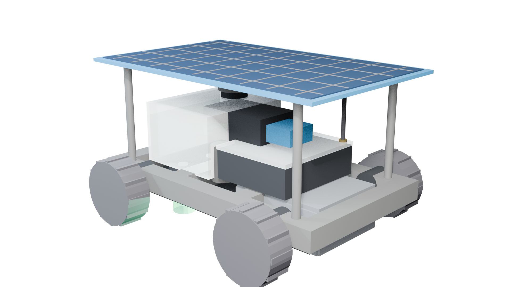
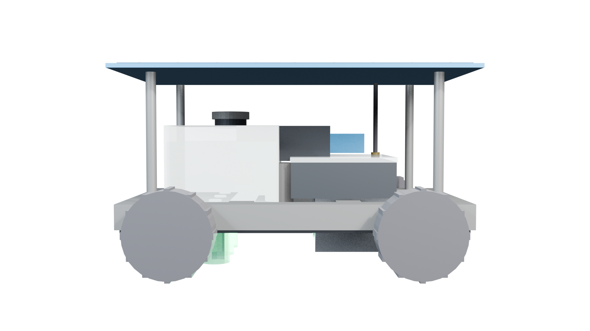

# 🚜 AGRO-PULSE
### Encoderless Sensor-Fusion Physical AI Rover for Precision Micro-Dosing & Fertigation

[](https://github.com/TeamTechtonics/Encoderless-Sensor-Fusion-Physical-AI-Precision-Rover)
[](https://github.com/TeamTechtonics/Encoderless-Sensor-Fusion-Physical-AI-Precision-Rover)
[](https://www.ashoka.edu.in/)
[](https://github.com/TeamTechtonics/Encoderless-Sensor-Fusion-Physical-AI-Precision-Rover)
[](cad/)
[](LICENSE)

---

## 🌟 Executive Summary

**AGRO-PULSE** is an autonomous, off-grid, encoderless solar-assisted **Physical AI rover** engineered for ultra-targeted apical micro-dosing of crop weeds and micro-injection of bio-liquid fertilizers in smallholder agriculture (cotton, soybean, and maize). 

By eliminating slip-prone wheel encoders and replacing them with a **ground-relative optical flow (PMW3901) + IMU body motion + Time-of-Flight (VL53L0X) sensor fusion loop**, the onboard **STM32G431 MCU** executes real-time **closed-loop PI velocity regulation** and **adaptive spatial displacement integration ($d(t) = \int v_{\text{ground}}(\tau)\,d\tau$)**. 

When accumulated displacement reaches the exact **200 mm physical camera-to-nozzle offset**, the high-speed **Active Zener snubber driver** fires sub-1.2 ms micro-droplets directly onto weed meristems—**reducing chemical usage and freshwater consumption by over 80%**.

<p align="center">
  
  <br>
  <em>Figure 1: High-Fidelity 3D Parametric CAD Model of the AGRO-PULSE Physical AI Rover (Modeled in Blender 5.2.1).</em>
</p>

---

## 📦 Mechanical & CAD Hardware Subsystems

The complete 3D mechanical CAD models, 3D printing STL files, universal OBJ meshes, and exploded views are located in the **[`cad/`](cad/)** folder:

* **[cad/agropulse_assembled.blend](cad/agropulse_assembled.blend):** Master 10-subassembly parametric 3D rover.
* **[cad/agropulse_cad_model.blend](cad/agropulse_cad_model.blend):** Exploded mechanical CAD assembly view.
* **[cad/agropulse_assembled.stl](cad/agropulse_assembled.stl):** Watertight 3D print ready mesh.
* **[cad/agropulse_assembled.obj](cad/agropulse_assembled.obj):** Universal Wavefront CAD interchange mesh.
* **[cad/README.md](cad/README.md):** Detailed technical specifications, GD&T tolerances, and 3D printing parameters.

<p align="center">
  
  <br>
  <em>Figure 2: Architectural internal cutaway detailing the 200 mm physical spatial offset between the front optical shroud vision bay and rear micro-solenoid manifold.</em>
</p>

---

## 🔬 Core Physical AI Architecture

```
[OV9281 Global-Shutter Camera] ──(Weed Coordinates X, Y @ t0)──> [Raspberry Pi 4B (Edge AI)]
                                                                           │
                                                                   (UART 115200 baud)
                                                                           │
                                                                           v
[PMW3901 Optical Flow] ──(Δx, Δy)───┐                           [STM32G431 Real-Time MCU]
[VL53L0X Laser ToF]   ──(h_ground)─┼─> [Sensor Fusion] ───────> • Closed-Loop PI Motor PWM (~0.30 m/s)
[BMI160 6-DOF IMU]    ──(a_x, ω_z)─┘                            • Spatial Integration d(t) = ∫ v dt
                                                                • Dynamic Pump Pressure (40 PSI)
                                                                           │
                                                      (When d(t) reaches EXACTLY 200 mm)
                                                                           │
                                                                           v
                                                            [Active Zener Snubber Driver]
                                                            • 12V 3ms Pull-In / 3.3V Hold
                                                            • Sub-1.2 ms Fast Demagnetization
                                                            • Zero Trailing Drip Micro-Dose
```

---

## 👥 Team TECHTONICS | Vishwakarma Awards 2026–27

* **Application ID:** `VK26-AU-PAI-0352`
* **Theme 7:** Physical AI for Resilience and Inclusion
* **Mentor Institute:** Ashoka University (Host) & Maker Bhavan Foundation
